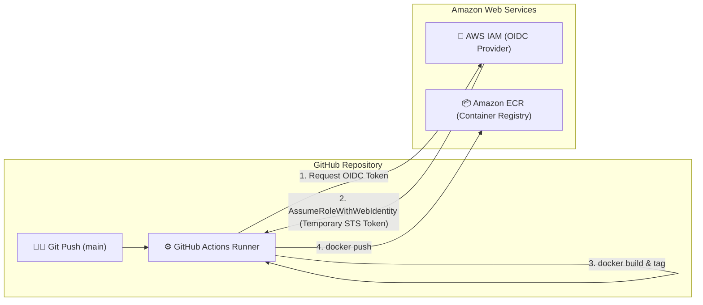

# 🚀 Next.js Automated CI/CD Pipeline to Amazon ECR via GitHub Actions & OIDC

[](https://github.com/shiranlakshitha/ECR-Next-js/actions/workflows/deploy.yaml)


A production-grade, automated DevOps pipeline that containerizes a **Next.js 15** web application with **Docker**, authenticates keylessly with **AWS IAM** via **OpenID Connect (OIDC)**, and publishes versioned images to **Amazon Elastic Container Registry (ECR)**.

---

## 📌 Architecture Diagram



---

## 🔒 Security Best Practice: Keyless OIDC vs Static IAM Keys

Traditional CI/CD pipelines store long-lived `AWS_ACCESS_KEY_ID` and `AWS_SECRET_ACCESS_KEY` in repository secrets. This approach introduces security risks (key rotation overhead, potential leakages, static privilege).

This project uses **OpenID Connect (OIDC)**:
* **Zero Long-Lived Secrets:** No static AWS credentials stored anywhere in GitHub.
* **Short-Lived STS Tokens:** AWS STS generates temporary credentials valid only for the duration of the workflow job.
* **Least Privilege:** The IAM Role trust relationship strictly limits access to this specific repository and branch:

```json
{
  "Version": "2012-10-17",
  "Statement": [
    {
      "Effect": "Allow",
      "Principal": {
        "Federated": "arn:aws:iam::<ACCOUNT_ID>:oidc-provider/token.actions.githubusercontent.com"
      },
      "Action": "sts:AssumeRoleWithWebIdentity",
      "Condition": {
        "StringEquals": {
          "token.actions.githubusercontent.com:aud": "sts.amazonaws.com"
        },
        "StringLike": {
          "token.actions.githubusercontent.com:sub": "repo:shiranlakshitha/ECR-Next-js:*"
        }
      }
    }
  ]
}
```

---

## 🛠️ Tech Stack

| Category | Technology |
| :--- | :--- |
| **Frontend Framework** | [Next.js 15 (App Router)](https://nextjs.org/), [React 19](https://react.dev/) |
| **Language & Styling** | [TypeScript](https://www.typescriptlang.org/), [Tailwind CSS](https://tailwindcss.com/) |
| **Container Engine** | [Docker](https://www.docker.com/) (Node.js 22 Alpine/Debian base) |
| **CI/CD Orchestration** | [GitHub Actions](https://github.com/features/actions) |
| **Container Registry** | [Amazon Elastic Container Registry (ECR)](https://aws.amazon.com/ecr/) |
| **Cloud Authentication** | AWS IAM Identity Provider (OIDC) + STS Web Identity |

---

## 📂 Project Structure

```text
├── .github/
│   └── workflows/
│       └── deploy.yaml         # GitHub Actions CI/CD deployment pipeline
├── app/                        # Next.js App Router pages and layouts
├── components/                 # Reusable React UI components
├── .dockerignore               # Ignores node_modules, .next, and git caches
├── dockerfile                  # Production container definition
├── next.config.mjs             # Next.js configuration
├── package.json                # Project dependencies and npm scripts
├── tailwind.config.ts          # Tailwind styling configuration
└── tsconfig.json               # TypeScript compiler configuration
```

---

## 🚀 Getting Started

### 1. Run Locally

```bash
# Clone the repository
git clone https://github.com/shiranlakshitha/ECR-Next-js.git
cd ECR-Next-js

# Install dependencies
npm install

# Start development server
npm run dev
```

Open [http://localhost:3000](http://localhost:3000) to view the application.

---

### 2. Test Docker Build Locally

```bash
# Build the Docker image
docker build -t nextjs-app .

# Run the container locally
docker run -p 3000:3000 nextjs-app
```

---

### 3. GitHub Secrets Configuration

To run the automated deployment pipeline, add the following secrets in your repository (**Settings > Secrets and variables > Actions > Secrets**):

| Secret Name | Description | Example |
| :--- | :--- | :--- |
| `AWS_REGION` | AWS Region hosting your ECR repository | `us-east-1` |
| `ECR_REPOSITORY` | Name of your Amazon ECR repository | `ecr-next-js` |
| `AWS_ROLE_TO_ASSUME` | Full IAM Role ARN with OIDC trust policy | `arn:aws:iam::123456789012:role/github-actions-ecr-role` |

---

### 4. Continuous Deployment Workflow

Every commit pushed to the `main` branch automatically triggers the [.github/workflows/deploy.yaml](.github/workflows/deploy.yaml) workflow:

1. **Check out code**: Clones the commit using `actions/checkout@v4`.
2. **Connect to AWS**: Assumes the IAM role keylessly via `aws-actions/configure-aws-credentials@v4` using OIDC.
3. **Log in to Amazon ECR**: Obtains Docker authentication token via `aws-actions/amazon-ecr-login@v2`.
4. **Build & Tag**: Builds the container image tagged with the commit SHA (`${{ github.sha }}`).
5. **Push**: Uploads the production image directly to Amazon ECR.

---

## 👤 Author

**Shiran Lakshitha**
- GitHub: [@shiranlakshitha](https://github.com/shiranlakshitha)
- LinkedIn: [Connect on LinkedIn](https://www.linkedin.com/)

---

## 📄 License

This project is licensed under the [MIT License](LICENSE).
